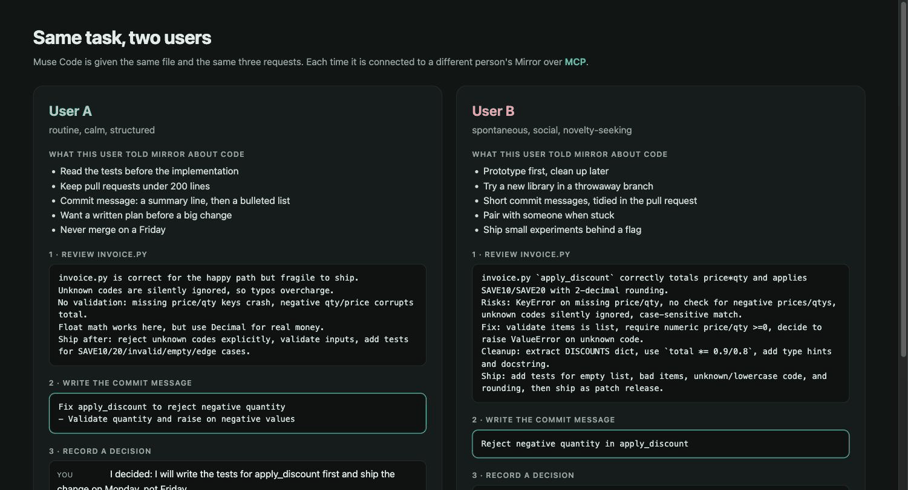
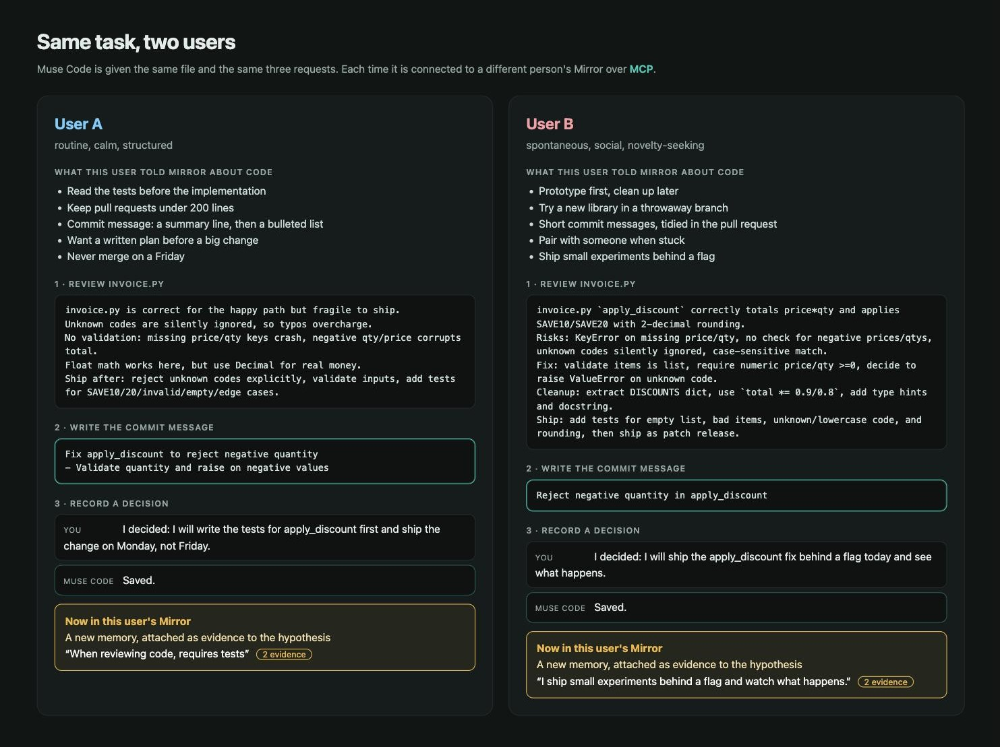
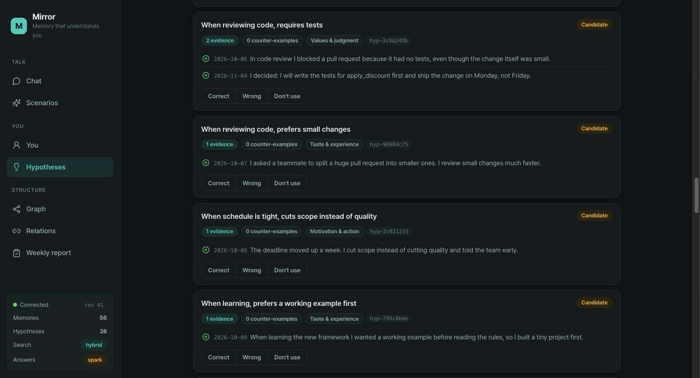
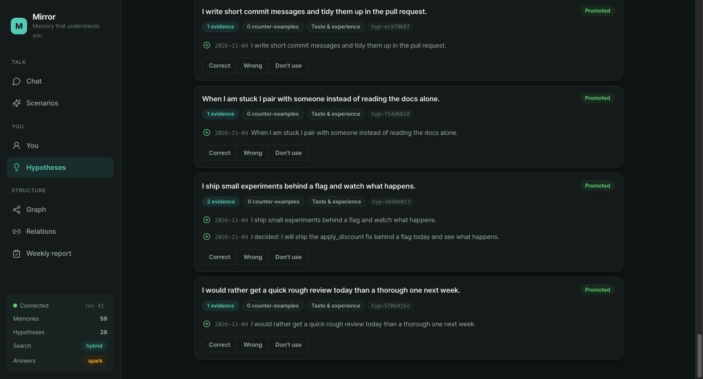

# Case: coding with Muse Code

The same file and the same three requests are given to Muse Code twice. Each time it is connected to a
different person's Mirror over MCP. The point is to see two things:

1. **Mirror changes what Muse Code does**, depending on whose Mirror it is.
2. **What the person decides in the conversation lands in their Mirror**, and shows up on the map.

<p align="center"></p>

## Setup

- Two made-up users, each in their own container (`docker compose up -d`), with the edge containers on
  (`docker compose --profile edge up -d`).
- Each user has six habits about code in their Mirror, told to it directly ("tell Mirror about you"),
  so no model key is needed for that part:
  [`habits-a.txt`](habits-a.txt) (reads tests first, small pull requests, a plan before a big change) and
  [`habits-b.txt`](habits-b.txt) (prototypes first, tries things in throwaway branches, ships behind a flag).
- Muse Code is pointed at that user's edge as an MCP server. The sample is [`sample/invoice.py`](sample/invoice.py),
  a small discount function.

## The three requests

| # | Request to Muse Code |
|---|---|
| 1 | Review `invoice.py`. Call `mirror_context` first and let it shape both the review and how to ship it. |
| 2 | Write the commit message for a fix that rejects a negative quantity. Follow what Mirror says about how this person writes them. |
| 3 | "I decided: ..." Save it with `mirror_remember`. |

For 3, User A said they would write the tests first and ship on Monday, not Friday. User B said they would
ship behind a flag today and see what happens.

## What came back



The clearest difference is the commit message. User A's Mirror says they write a summary line followed by a
list, and that is what they got. User B's says they write short messages and tidy them later, and they got one line.

| | User A | User B |
|---|---|---|
| Commit message | `Fix apply_discount to reject negative quantity` and a bullet | `Reject negative quantity in apply_discount` |
| How the review ends | "Ship after: ... add tests for SAVE10/20/invalid/empty/edge cases." | "Ship: add tests for ..., then ship as patch release." |

## What landed in Mirror

Muse Code reported "Saved." both times. Each decision became a new memory (55 to 56 for each user) and was
attached as evidence to a hypothesis that was already there:

<table>
<tr>
<td width="50%"></td>
<td width="50%"></td>
</tr>
<tr>
<td valign="top"><b>User A.</b> <i>When reviewing code, requires tests</i> now has two pieces of evidence: an earlier review where they blocked a pull request for having no tests, and the decision saved from Muse Code.</td>
<td valign="top"><b>User B.</b> <i>I ship small experiments behind a flag and watch what happens</i> now has two: what they told Mirror, and the decision saved from Muse Code.</td>
</tr>
</table>

## Reproduce it

```sh
docker compose up -d
bash scripts/seed-code-habits.sh                 # the habits above, into both users
echo 'META_API_KEY=...' >> .env && docker compose up -d user-a user-b   # so a saved decision can be learned
bash scripts/mirror-code-case.sh                 # runs the three requests for both users
```

`mirror-code-case.sh` needs `muse` to be able to reach its login (a terminal where the keychain is unlocked,
or `META_API_KEY` set in the shell). It writes the results to `out/` and puts your Muse settings back when it
finishes. The saved outputs of the run shown here are in [`out/`](out/).

## What this does and does not show

- **One run per user.** Model output varies from run to run. The commit messages matched each user's habit here;
  that is what was observed, not a measured rate.
- **The habits were put in by hand**, as the people's own statements. This case is about what Mirror does with
  them, not about learning them from conversations.
- **The reviews differ less than the commit messages.** Both end with "add tests, then ship". The wording
  and what each stresses differ, but this is not a sharp contrast. I did not see the exact request Muse Code
  sent to Mirror. In a similar test question Mirror returned nothing for User B, because it only returns what
  it judges relevant. The commit message and the saved decision are the clearer results.
- The decision in step 3 was learned with a model (`META_API_KEY`), unlike the habits.
